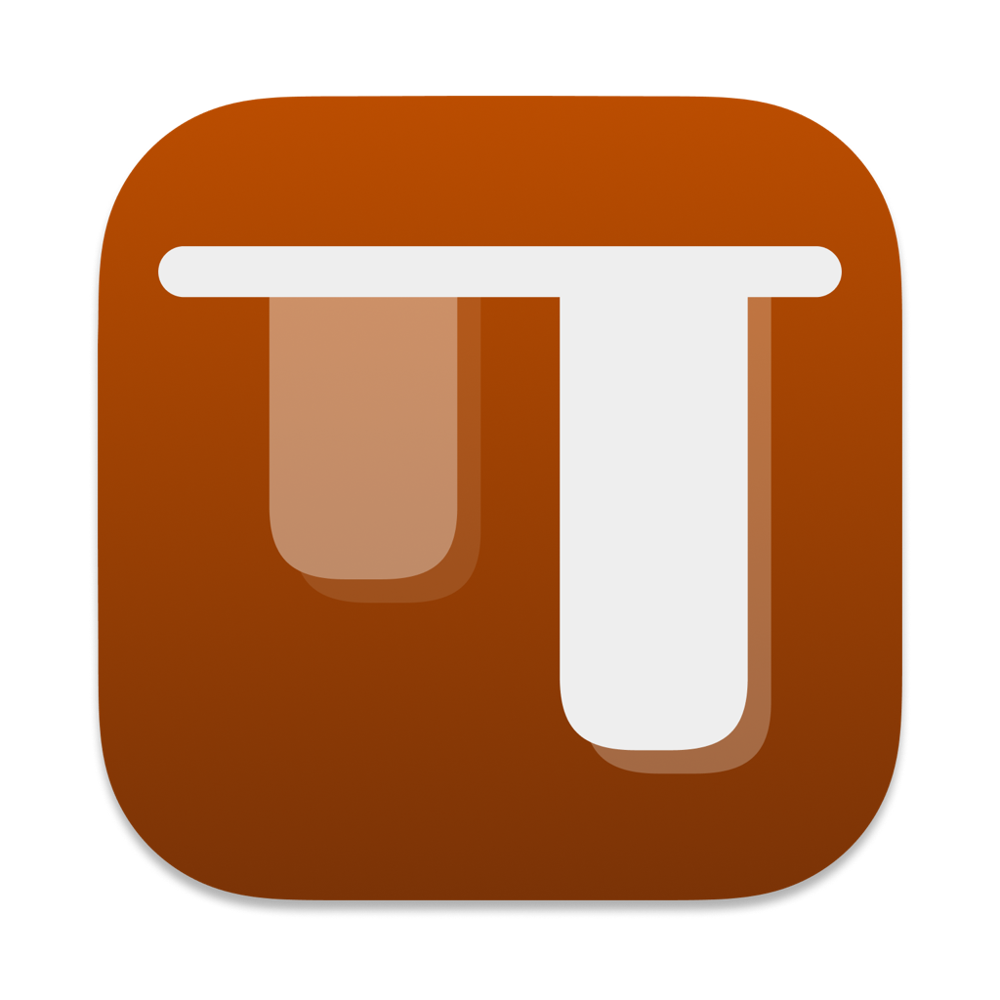

<p align="center">
  <a href="https://lanework.dev">
    
  </a>
</p>

<h1 align="center">Lanework</h1>

<p align="center">A desktop home and a Kanban board for your coding agents.</p>

<p align="center">
  <a href="https://github.com/fuongz/lanework/releases/latest"><strong>Download</strong></a>
  &nbsp;&nbsp;|&nbsp;&nbsp;
  <a href="https://lanework.dev">Website</a>
  &nbsp;&nbsp;|&nbsp;&nbsp;
  <a href="./docs/development.md">Develop</a>
</p>

Lanework runs the coding agents already on your machine, Claude Code, Codex and OpenCode, in one app, and keeps their work on a board. Every task is a card: decisions you approve, then checks that prove the work. Agents pick cards up, leave a checkpoint after each turn, and another agent can carry on where the last one stopped.

## What you get

- **Your subscriptions.** Lanework does not resell tokens. It drives the agents you are already signed in to.
- **A board agents can use.** The Lanework MCP server lets an agent read, create and tick cards, on a board in the cloud or one that lives on this machine.
- **Handoff between agents.** A hook saves progress on the card after every turn, so Claude Code can pick up where Codex left off, on this machine or another.
- **Conductors.** A lead agent splits a large task into a run of workers, picks their models and reviews what each one returns.
- **Fast search for agents.** Lanework Kit (`lwk`) gives agents file, text, code-shape and past-chat search that is faster and quieter than the shell.
- **Git built in.** Worktrees, changes, history and pull requests, next to the chat.
- **Open.** The desktop app and the Claude Code plugin are MIT licensed.

## Install

### Desktop app

[Download the latest release](https://github.com/fuongz/lanework/releases/latest) for macOS on Apple Silicon (`Lanework-<version>-arm64.dmg`), open it and drag Lanework to Applications. The app updates itself.

### Sign in to an agent

Lanework needs at least one agent that is installed and signed in. For example, install [Claude Code](https://claude.com/product/claude-code) and run `claude auth login`, or install [Codex CLI](https://developers.openai.com/codex/cli) and run `codex login`. Lanework sets up its MCP servers and hooks for them from **Settings → Harness**.

### Claude Code plugin

Without the app, the plugin from [lanework-dev/plugins](https://github.com/lanework-dev/plugins) brings the board's MCP tools and the checkpoint hook to Claude Code:

```text
/plugin marketplace add lanework-dev/plugins
/plugin install lanework@lanework
```

### Lanework Kit on the command line

The app ships `lwk`. To use it on its own, from [lanework-dev/kit](https://github.com/lanework-dev/kit):

```bash
brew install lanework-dev/tap/lanework-kit
```

## Documentation

- [How Lanework works](./docs/architecture/overview.md)
- [Lanework Kit](./docs/architecture/lanework-kit.md)
- [The checkpoint hook](./docs/agents/checkpoint-hook.md)
- [Release notes](./.agents/release-notes/)

[All docs](./docs/README.md) has the full list.

## Contributing

Small, focused fixes are the most likely to be merged. The API and the remote MCP server are not in this repository.

- Read [CONTRIBUTING.md](./CONTRIBUTING.md) before you report a bug or open a pull request.
- Build and run from source with the [development guide](./docs/development.md).
- Agents working in this repository follow [AGENTS.md](./AGENTS.md).

## License

[MIT](./LICENSE). The Lanework name and logo are covered by [TRADEMARKS.md](./TRADEMARKS.md).
